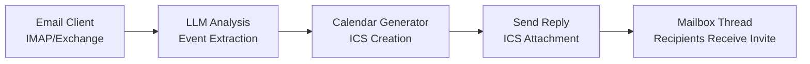

# iCal Bot - Automated Email to Calendar System

An intelligent bot that monitors your email inbox, uses a local LLM to detect event descriptions, and automatically creates and sends calendar invites (.ics files) as replies.

## Features

- 📧 **Email Integration**: Connects to your email via IMAP/SMTP
- 🤖 **AI-Powered Event Detection**: Uses a local LLM (Ollama) to identify events in email content
- 📅 **Calendar Invite Generation**: Creates standard iCalendar (.ics) files
- ↩️ **Automatic Replies**: Sends calendar invites as threaded replies so all recipients benefit
- 📊 **Dashboard & Approvals**: Monitor detections, inspect raw LLM responses, and approve invites before they are sent
- 🗃️ **Persistent Audit Log**: SQLite-backed history of every processed email (events and non-events) with filtering
- 🔄 **Continuous Monitoring**: Runs in the background checking for new emails
- 💾 **Deduplication**: Tracks processed emails to avoid duplicates

## Prerequisites

1. **Python 3.11+** (managed with `uv`)
2. **Ollama** - A local LLM server
   - Install from: https://ollama.ai/
   - Pull a model: `ollama pull gpt-oss:20b` (or any other model)
3. **Email Account** with IMAP/SMTP or Exchange (EWS) access
   - For Gmail: Enable "App Passwords" in your Google Account settings
   - For other providers: Check their IMAP/SMTP documentation

## Installation

1. **Clone or download this repository**

2. **Install Python dependencies** (`pyproject.toml` + `uv`):
   ```bash
   uv sync
   ```

3. **Set up Ollama** (if not already installed):
   ```bash
   # Install Ollama via your OS package manager or verify the download at https://ollama.com/download
   
   # Pull a model (e.g., llama3.2)
   ollama pull llama3.2
   
   # Start Ollama server (runs on http://localhost:11434 by default)
   ollama serve
   ```

## Configuration

### Option 1: Environment Variables (Recommended)

Create a `.env` file in the project directory (and restrict its permissions to owner-only):

```bash
cp .env.example .env
chmod 600 .env
```

```bash
# Email Configuration
EMAIL_ADDRESS=your-email@gmail.com
# EMAIL_PASSWORD=your-app-password  # Optional if you enter it via the Web UI

# Gmail IMAP/SMTP (default)
IMAP_SERVER=imap.gmail.com
IMAP_PORT=993
SMTP_SERVER=smtp.gmail.com
SMTP_PORT=587

# Exchange Autodiscover (keep false unless temporarily discovering on a trusted network)
EXCHANGE_AUTODISCOVER=false

# LLM Configuration
LLM_ENDPOINT=http://localhost:11434/api/chat
LLM_MODEL=llama3.2
LLM_MAX_EVENTS_PER_EMAIL=5       # Keep top N event candidates per email
LLM_DEFAULT_DURATION_MINUTES=60  # Fallback duration when end time is unspecified
# LLM_DURATION_RULES_JSON=[]     # Optional custom JSON duration keyword rules
ATTACHMENT_PARSING_ENABLED=true
ATTACHMENT_MAX_FILES_PER_EMAIL=5
ATTACHMENT_MAX_FILE_SIZE_BYTES=5242880
ATTACHMENT_MAX_TEXT_CHARS=12000
ATTACHMENT_MAX_PDF_PAGES=20
ATTACHMENT_MAX_UNCOMPRESSED_BYTES=10485760  # Cap decompressed DOCX XML against zip bombs

# Optional Settings
CHECK_INTERVAL_SECONDS=300
MAX_EMAILS_PER_CHECK=10
DEFAULT_TIMEZONE=Europe/Berlin
ORGANIZER_NAME=iCal Bot
ORGANIZER_EMAIL=${EMAIL_ADDRESS}   # Sender identity for the organizer field in ICS; keep internal
INTERNAL_EMAIL_DOMAIN=example.com  # Optional internal domain used for organizer fallback and UI auto-deselect
INVITE_SUBJECT_PREFIX=             # Optional prefix for invite subject lines
INVITE_SUBJECT_SUFFIX=" (iCal-Bot)"# Suffix indicating invite generated by bot

# Exchange Direct Calendar Configuration (Option A: native Outlook editability)
EXCHANGE_DIRECT_CALENDAR_CREATION=true   # Save directly to Exchange calendar folder so you are organizer
EXCHANGE_CALENDAR_INVITE_ATTENDEES=true  # Dispatch invitations to external attendees selected in UI
EXCHANGE_SEND_CONFIRMATION_EMAIL=false   # Optional confirmation email to thread
CALENDAR_ITEM_CATEGORY="iCal-Bot"        # Category badge in Outlook

RESULTS_DB_PATH=data/processed_results.db
AUTO_APPROVE_EVENTS=false                  # Set to true to skip UI approval (bypassed on prompt injection/external recipients)
AUTO_APPROVE_ALLOW_EXTERNAL_RECIPIENTS=false # Require manual review for external recipients even when AUTO_APPROVE_EVENTS=true
ENFORCE_INTERNAL_RECIPIENT_DOMAIN=false    # When true, drop outbound recipients outside INTERNAL_EMAIL_DOMAIN
ENABLE_DEBUG_DUMPS=false   # Set true to persist outbound .eml and LLM debug artifacts
LLM_DEBUG_DIR=             # Path for LLM debug dumps (ignored unless ENABLE_DEBUG_DUMPS=true)
REQUIRE_HTTPS_FOR_REMOTE=true
REQUIRE_HTTPS_FOR_LLM=true
TRUSTED_PROXY_COUNT=0      # Set >0 only when running behind a trusted reverse proxy (e.g., 1 for nginx)
SESSION_COOKIE_SECURE=false # Set true when always served over HTTPS (also auto-enabled per-request on HTTPS)
SESSION_LIFETIME_HOURS=12  # Session idle/max lifetime in hours
```

### Option 2: Edit config.py directly

Alternatively, you can edit the default values in `config.py`.

### Gmail Setup

For Gmail users:
1. Go to Google Account settings → Security
2. Enable 2-Factor Authentication
3. Create an "App Password" for "Mail"
4. Use this app password in your configuration (not your regular password)

### Other Email Providers

Update the IMAP/SMTP settings for your provider:
- **Outlook**: imap-mail.outlook.com:993, smtp-mail.outlook.com:587
- **Yahoo**: imap.mail.yahoo.com:993, smtp.mail.yahoo.com:587
- **Custom**: Check your provider's documentation

## Usage

### Run Continuously (Recommended)

The bot will check your inbox every 5 minutes (configurable):

```bash
python main.py
```

Press `Ctrl+C` to stop.

### Run Once

Process current emails and exit:

```bash
python main.py --once
```

### Run Backend + Frontend Together

Start both the processing backend and the web dashboard from one command:

```bash
python run.py
```

- Backend (email processing) and frontend (Web UI) start together.
- Open `http://127.0.0.1:5000` in your browser.
- Use `python run.py --no-web` to run backend only.

### What Happens

1. Bot connects to your email inbox
2. Fetches new/unprocessed emails
3. For each email:
   - Sends email content to the local LLM
   - LLM analyzes if it contains event information
   - If event detected:
     - Creates a calendar invite (.ics file)
     - Sends a reply to the original email thread with the invite attached
     - All recipients in the thread receive the calendar invite
4. Tracks processed emails to avoid duplicates

### Web Dashboard & Approvals

Launch the dashboard (optional but recommended) in a separate terminal:

```bash
python web_ui.py
```

- Navigate to `http://127.0.0.1:5000` to see the live feed
- Click any record to inspect the redacted LLM prompt/response, extracted event candidates, and ICS payload
- Required approvals (default) appear under the “Pending approvals” count and can be sent with a single click
- Set `AUTO_APPROVE_EVENTS=true` in `.env` if you prefer the bot to send invites automatically for trusted internal emails without UI approval (entries flagged for prompt injection or containing external recipients still require manual approval unless `AUTO_APPROVE_ALLOW_EXTERNAL_RECIPIENTS=true`)
- Attachment text extraction is enabled by default and can be turned on/off in the dashboard via the “Attachments: ON/OFF” control

**Local UI authentication**
- On first run from localhost, open `/setup` to create your UI username and password (**minimum 12 characters**).
- `/setup` is local-only; after setup, sign in via `/login` (rate-limited to 5 failed attempts per 15 minutes per IP) and use **Sign out** (`POST /logout`) to end your session. Password managers can save this login.

**Mailbox credentials via UI**
- If `EMAIL_PASSWORD` is not set, the UI prompts you to enter the mailbox password once via a CSRF-protected JSON request. It is kept in memory only.

**Prompt-injection & recipient guardrails**
- Entries flagged as potential prompt injection (across subject, body, and boundary tag spoofing) are marked in the UI and automatically bypass `AUTO_APPROVE_EVENTS` to require manual review.
- Set `ENFORCE_INTERNAL_RECIPIENT_DOMAIN=true` to strictly drop outbound recipients outside `INTERNAL_EMAIL_DOMAIN`.

**Data minimization & unified SQLite persistence**
- Email bodies are never stored in `email_body` and are redacted from `llm_prompt` before persistence.
- All processed email state, results, approval logs, and IMAP `UIDVALIDITY`/high-water UID watermarks live in SQLite (`data/processed_results.db` using WAL journal mode, secondary indexes, and 5-second `busy_timeout`). Legacy `processed_emails.json` IDs are imported automatically once on startup and left untouched.
- On startup the app runs a redaction pass (`censor_sensitive_fields()`, including SQLite WAL checkpoint + `VACUUM` to wipe freed pages) and purges entries older than 1 month. Manual purge deletes entries older than 1 week.

**Custom local hostname (password manager-friendly):**
If your password manager ignores ports for localhost, map a custom hostname to 127.0.0.1 and use it in the browser.

Example (OS-agnostic):
1. Add a hosts entry for a local name (e.g., `icalbot.local`) pointing to `127.0.0.1` in your system hosts file.
2. Set `WEB_UI_HOST=icalbot.local` in `.env`.
3. Open `http://icalbot.local:5000`.

**Hosts file locations (by OS):**
- **Windows**: Edit as Administrator `C:\Windows\System32\drivers\etc\hosts` and add:
   `127.0.0.1  icalbot.local`
- **macOS**: Edit `/etc/hosts` and add:
   `127.0.0.1  icalbot.local`
- **Linux**: Edit `/etc/hosts` and add:
   `127.0.0.1  icalbot.local`

## How It Works

### Architecture



### Components

- **`src/ical_bot/settings.py` & `config.py`**: Typed `Settings` snapshot + locked environment configuration
- **`src/ical_bot/runtime.py` & `run.py`**: Single-coordinator `BotRuntime` (exclusive polling/manual-scan lock) serving the UI under Waitress WSGI
- **`src/ical_bot/mail/` (`protocol.py`, `common.py`), `email_client.py`, `exchange_client.py`**: `MailAdapter` Protocol + shared MIME composition and header-first UID/Message-ID skip logic for IMAP/SMTP and Exchange EWS
- **`src/ical_bot/llm/` (`schemas.py`, `duration_rules.py`) & `llm_client.py`**: Ollama `/api/chat` with JSON Schema structured outputs (plus `/api/generate` compatibility) and configurable `DurationRule` heuristics
- **`src/ical_bot/web/` & `web_ui.py`**: Modular Flask application factory (`create_app()`) with Blueprints (`auth`, `events`, `manual`, `admin`) and `EventWorkflow`
- **`static/css/` & `static/js/`**: Externalized stylesheets (`auth.css`, `app.css`) and native ES modules (`api.js`, `ics.js`, `calendar.js`, `events.js`, `manual-eval.js`, `app.js`)
- **`storage.py` & `main.py`**: SQLite WAL persistence, legacy state migration, and core email-processing loop
- **`calendar_generator.py`**: Standards-compliant iCalendar (`.ics`) generation
- **`src/ical_bot/time_utils.py` & `identifiers.py`**: Shared UTC/timezone helpers and stable `Message-ID`-anchored email hashing

### Event Detection

The LLM analyzes emails for:
- Meeting requests
- Appointment scheduling
- Event announcements
- Time-specific activities

It extracts:
- Event title
- Date and time (handles relative dates like "next Monday")
- Duration (assumes 1 hour if not specified)
- Location (physical or virtual)
- Description

If multiple concrete event times are present in one email, the bot stores multiple event candidates (capped by `LLM_MAX_EVENTS_PER_EMAIL`) and requires manual selection in the UI before sending.

## Example

**Input Email**:
```
Subject: Team Meeting Next Week

Hey team,

Let's have our weekly sync next Monday at 2 PM. 
We'll meet in Conference Room B and discuss Q1 goals.

Duration: 1 hour

See you there!
```

**Bot Action**:
1. Detects event: "Team Meeting"
2. Extracts: Date (next Monday), Time (2 PM), Location (Conference Room B), Duration (1 hour)
3. Creates calendar invite
4. Replies to email with .ics attachment
5. All recipients can add to their calendars

## Troubleshooting

### LLM Connection Issues
```bash
# Check if Ollama is running
curl http://localhost:11434/api/tags

# Start Ollama if needed
ollama serve
```

### Email Authentication Errors
- Gmail: Ensure you're using an App Password, not your regular password
- Check IMAP/SMTP settings for your provider
- Verify 2FA is enabled (for Gmail)

### No Events Detected
- The LLM might need a better model (try `ollama pull llama3` for a larger model)
- Check the email content is clear about the event details
- Review logs for LLM responses

### Calendar Invites Not Sending
- Check SMTP configuration
- Verify email credentials
- Check logs for specific error messages

## Customization

### Change LLM Model
```bash
# Pull a different model
ollama pull mistral

# Update .env or config.py
LLM_MODEL=mistral
```

### Adjust Check Interval
```bash
# In .env or config.py
CHECK_INTERVAL_SECONDS=600  # 10 minutes
```

### Customize Reply Message
Tweak the `build_reply_message` helper in `messaging.py` to change disclaimers or formatting.

## Security Notes

- Never commit `.env` file or credentials to version control, and keep `.env`, `processed_emails.json`, and `data/` owner-only (`chmod 700 data && chmod 600 .env data/*`)
- Never commit runtime files in `data/` (auth store/secret, SQLite DB, temp credentials)
- Use app-specific passwords, not your main email password
- Keep your LLM local to maintain privacy; non-local LLM endpoints must use HTTPS (`REQUIRE_HTTPS_FOR_LLM=true`)
- IMAP/SMTP connections enforce TLS 1.2+ with certificate and hostname verification; Exchange Autodiscover is disabled by default (`EXCHANGE_AUTODISCOVER=false`) to avoid credential exposure on untrusted networks
- Web UI enforces per-session CSRF tokens, same-origin checks, strict CSP (`script-src 'self' 'nonce-...'` and `style-src 'self'` with zero `'unsafe-inline'`), `X-Frame-Options: DENY`, `X-Content-Type-Options: nosniff`, `Referrer-Policy: same-origin`, `HttpOnly`/`SameSite=Lax` cookies (plus `Secure` on HTTPS), 1 MiB max request size, and 12-hour session lifetimes
- Keep `TRUSTED_PROXY_COUNT=0` unless deployed behind a trusted reverse proxy so `X-Forwarded-Proto` cannot be spoofed
- Attachment extraction is limited to bounded, text-safe formats (`.txt`, `.md`, `.csv`, `.log`, `.pdf`, `.docx`) using `defusedxml` and uncompressed XML size caps (`ATTACHMENT_MAX_UNCOMPRESSED_BYTES`) against zip bombs, and can be disabled in the UI
- The systemd unit (`ical-bot.service`) enforces `NoNewPrivileges=true`, `PrivateTmp=true`, `ProtectSystem=strict`, and `UMask=0077`

## Background Service & Opportunistic Execution

### 🚀 Running as a Background Service (systemd)

You can run iCal Bot as an automated background service that survives terminal closures and reboots:

#### User Service (Recommended, No Sudo Required)
Runs in your user session and logs to your user journal:
```bash
# Install and auto-start under your user account:
bash install_service.sh install --user

# Useful management commands:
bash install_service.sh status --user    # Check running status
bash install_service.sh logs --user      # Follow live journal logs
bash install_service.sh restart --user   # Restart service
bash install_service.sh uninstall --user # Stop and remove service
```

#### System Service (System-Wide, Auto-Starts on Boot)
```bash
# Install and enable system-wide service:
sudo bash install_service.sh install

# Useful management commands:
sudo bash install_service.sh status
sudo bash install_service.sh logs
sudo bash install_service.sh restart
sudo bash install_service.sh uninstall
```

---

### 🛡️ Opportunistic Workload Yielding & Cooldown Management

When running on a shared workstation or a machine used for graphics/ML tasks (e.g. PyTorch, Blender, 4DGS simulations):
- **GPU Activity Monitoring**: Monitors `nvidia-smi` compute processes. If a non-whitelisted process exceeds `WORKLOAD_VRAM_THRESHOLD_MB` (default: 500 MiB), the bot immediately yields.
- **GPU Utilization Monitoring**: Monitors GPU utilization percentage. If non-Ollama activity exceeds `WORKLOAD_GPU_UTIL_THRESHOLD` (default: 30%), the bot yields.
- **Host CPU Load Monitoring**: Checks consecutive `/proc/stat` CPU usage against `WORKLOAD_CPU_THRESHOLD_PCT` (default: 70%).
- **Native Model Unloading**: Unlike containerized environments, the bot natively unloads the LLM from VRAM via Ollama's HTTP API (`keep_alive: 0`) and `ollama stop`, freeing GPU memory completely.
- **Backoff Cooldown**: Enters a configurable cooldown (`WORKLOAD_COOLDOWN_SECONDS`, default: 300s) before re-attempting LLM operations.
- **Automatic Retrying of Timed-Out Requests**: When an LLM request times out due to system load or preemption, it triggers cooldown and the email is **not** discarded or marked as failed. Instead, the bot waits for the system to become idle and automatically retries processing as soon as the LLM is available again.

Configure thresholds in `.env`:
```env
WORKLOAD_MONITOR_ENABLED=true
WORKLOAD_VRAM_THRESHOLD_MB=500
WORKLOAD_GPU_UTIL_THRESHOLD=30
WORKLOAD_CPU_THRESHOLD_PCT=70
WORKLOAD_CPU_SUSTAINED_POLLS=3
WORKLOAD_COOLDOWN_SECONDS=300
```

---

## Deployment (Docker + reverse proxy)

1. Copy `.env.example` to `.env`, set `chmod 600 .env`, and fill in real values. Keep `ENABLE_DEBUG_DUMPS=false` in production.
2. Build and run via Docker Compose:
   ```bash
   docker compose build
   docker compose up -d
   ```
   The container runs Flask under single-worker Gunicorn (`web_ui:create_wsgi_app()`, which launches the single-coordinator `BotRuntime` background polling worker and preserves in-memory mailbox credentials); `docker-compose.yml` sets `TRUSTED_PROXY_COUNT=1` so the bundled nginx reverse proxy's `X-Forwarded-Proto` is trusted. Enable TLS and mount certs in `deploy/nginx.conf` (which also enforces `client_max_body_size 1m`, security headers, and `/login` rate limiting) before exposing remotely.
3. Ollama access: when using Docker, set `LLM_ENDPOINT` to `https://<host>/api/chat` (or `http://host.docker.internal:11434/api/chat` with `REQUIRE_HTTPS_FOR_LLM=false` only on an isolated local host bridge). Legacy `/api/generate` endpoints remain supported.
4. Auth: on first run, open `/setup` from localhost to create your UI login (minimum 12 characters), then continue with `/login`.
5. File permissions: restrict `data/` (`0700`) and the SQLite DB/auth files (`0600`) to the service user; do not bake secrets into images.

## Limitations

- Requires emails to have clear event descriptions
- LLM accuracy depends on the model and email clarity
- Attachment extraction is best-effort and intentionally bounded by file size/page/character limits
- Timezone handling is basic (defaults to UTC)

## Future Enhancements

- Support for recurring events
- Better timezone detection
- Integration with calendar APIs (Google Calendar, Outlook)
- Web interface for monitoring
- Support for updating existing events

## Development & Verification

```bash
# Python backend, security, and architectural regression suite
uv run pytest -q

# Frontend JavaScript syntax check and Node unit tests
node --check static/js/*.js
node --test tests/js/test_frontend_modules.mjs

# Linting, static type checking, and dependency vulnerability audit
uv run ruff check src tests *.py
uv run mypy src/ical_bot
uv run pip-audit
```

## License

GNU General Public License v3.0 (GPLv3). See `LICENSE`.

## Support

For issues or questions:
1. Check the logs for error messages
2. Verify your configuration settings
3. Test LLM connectivity separately
4. Ensure email credentials are correct

---

**Happy Scheduling! 📅**
